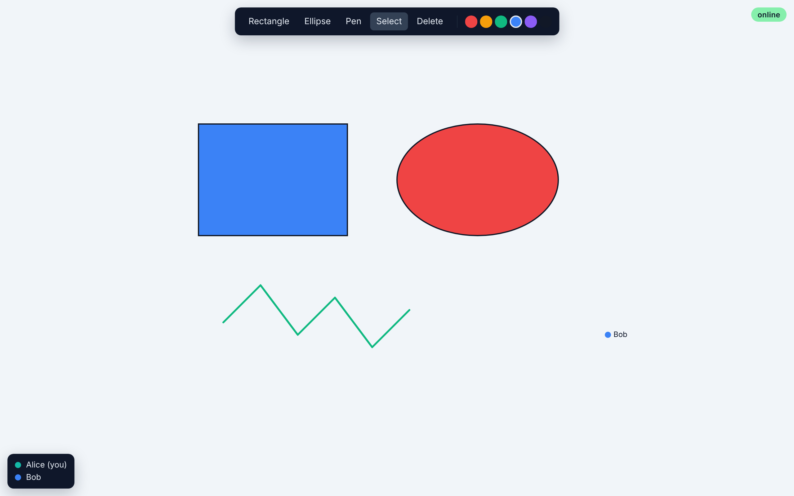
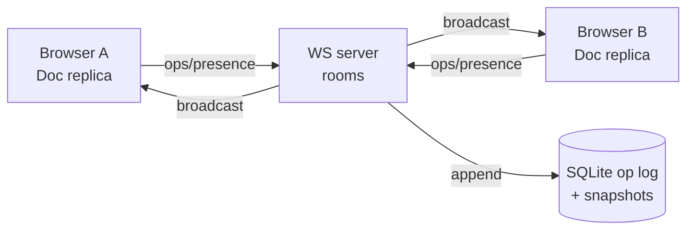

# collab-canvas

A real-time collaborative whiteboard where every shape is a set of hand-written last-writer-wins registers, so concurrent edits converge without a central arbiter.

[](https://github.com/xJDvm/collab-canvas/actions/workflows/ci.yml)



## Why it is hard

The canvas is the easy part. The difficult part is making several replicas agree when messages arrive reordered, duplicated or late.

- **Convergence under reordering and duplication.** Each field of a shape (`x`, `y`, `w`, `h`, `fill`, `stroke`, `z`, the points of a stroke, and a deletion tombstone) is an independent last-writer-wins register. Writes are ordered by a Lamport stamp `(lamport, replica)`. Ties on `lamport` are broken by the replica id, so the order is total and every replica picks the same winner.
- **Idempotence.** Every operation has a unique id, `"<replica>:<lamport>"`. A replica remembers the ids it has applied and ignores repeats.
- **Updates before creates.** An update may arrive before the create it refers to. The record is buffered and stays invisible until the create arrives, so the application order does not change the result.
- **Deletes that stay deleted.** A delete leaves a tombstone. A shape with a tombstone is hidden whatever the stamps of its updates are, so a delete wins over concurrent updates, always. This is not a stamp-ordered delete.
- **The server is a relay and a log, never an arbiter.** It persists each accepted operation, applies it to its own copy to build snapshots, and forwards it to the other members. It never authors operations and never resolves conflicts. It rejects malformed operations and duplicates. If the document still refuses an operation after it was logged, the server does not broadcast it and replies with `invalid_op`.
- **Hostile input.** Every inbound frame goes through a hand-written validator with size, rate and connection limits. Validated objects are rebuilt field by field from a whitelist, so unknown keys and `__proto__` cannot leak into state.

## Architecture



Modules (npm workspaces):

| Path | Role |
| --- | --- |
| `packages/crdt` | Document CRDT: Lamport clock, LWW registers, operations, strict validator. No dependencies. |
| `packages/server` | WebSocket server (`ws`): frame parser, token-bucket rate limiter, rooms, SQLite op log with snapshots (`node:sqlite`), entry point. |
| `packages/web` | React and Vite client: reconnecting WebSocket session, canvas renderer, pointer tools, presence, UI. |
| `e2e` | Playwright tests that drive two browser contexts in one room. |

## Quick start

Requires Node.js 22.13 or newer. The server uses the built-in `node:sqlite` module, which needs Node 22.13 at minimum. On Node 22 it prints an `ExperimentalWarning` about SQLite at startup; this is expected. The root `package.json` declares `"engines": { "node": ">=22" }`, which is looser than the real minimum; tightening it to `>=22.13` is a known gap (see Limitations).

```sh
npm ci
npm run dev
```

Then open http://localhost:5173/#room=demo in two browser tabs and draw in one of them.

`npm run dev` runs `tsc -b`, then starts the WebSocket server and the Vite client. The Vite dev server does not set a `host`, so it serves on `localhost:5173`. The server binds `HOST` and `PORT` (default `127.0.0.1:8787`). Vite proxies `/ws` to `ws://127.0.0.1:8787` (set in `packages/web/vite.config.ts`), so the browser only talks to the Vite origin.

The server reads three environment variables, all optional: `HOST` (default `127.0.0.1`), `PORT` (default `8787`) and `DB_PATH` (default `./collab-canvas.db`). The Vite proxy target is not derived from them; if you change `HOST` or `PORT`, change `vite.config.ts` as well.

## Usage

The CRDT can be used without the server. This example runs inside the monorepo, because `@collab-canvas/crdt` is a private workspace package and is not published:

```ts
import { Doc } from "@collab-canvas/crdt";

const alice = new Doc("alice");
const bob = new Doc("bob");

// Alice creates a rectangle and sends the operation to Bob.
const create = alice.createShape({
  kind: "rect", x: 10, y: 10, w: 120, h: 60, fill: "#ffcc00", stroke: "#202020", z: 1,
});
bob.apply(create);

// Bob moves it. Alice applies the operation.
const move = bob.updateShape(create.id, { x: 200 });
alice.apply(move);

alice.apply(move); // false: the operation was already applied
alice.visibleShapes(); // the rectangle, now at x = 200
```

Wire protocol (JSON text frames). A client joins a room and then sends operations and cursor positions:

```json
{"type":"hello","room":"demo","replica":"k3J9x_Qw2"}
{"type":"op","op":{"type":"update","id":"k3J9x_Qw2:4","stamp":{"lamport":4,"replica":"k3J9x_Qw2"},"shapeId":"alice:1","fields":{"x":200}}}
{"type":"presence","x":512.5,"y":240,"name":"Brave Otter 42","color":"#ff6b6b"}
```

After a valid `hello`, the server replies with `welcome`. Its `snapshot` field is the full current state of the room, and its `ops` field is always an empty array. The server then relays `op`, `presence` and `leave` frames, and sends `error` with a fixed message and a code (`invalid_frame`, `invalid_op`, `hello_required`, `rate_limited`, `room_full`, `replica_in_use`).

## Commands

| Command | What it does |
| --- | --- |
| `npm run typecheck` | Type-checks every package with `tsc -b`. |
| `npm run lint` | Runs `eslint .` over the repository. |
| `npm test` | Type-checks, then runs the Vitest suites of `crdt`, `server` and `web`. |
| `npm run dev` | Type-checks, then starts the WebSocket server (`127.0.0.1:8787` by default) and the Vite client (`localhost:5173`). |
| `npm run e2e` | Runs the Playwright suite in Chromium. Browsers must be installed first with `npx playwright install chromium`. |
| `npm run build -w @collab-canvas/web` | Builds the client into `packages/web/dist/app`. This is a workspace script; the root `package.json` has no `build` script. |

The e2e configuration starts `npm run dev` itself and reuses a server that is already running on port 5173. To run the e2e suite with a Chromium you already have, set `PW_CHROMIUM` to its executable path. Playwright then uses that binary instead of its own download.

`npm run e2e` also runs `e2e/screenshots.spec.ts`, which rewrites `docs/screenshot.png` (the image at the top of this README).

## CRDT invariants

These four properties are tested, not only documented:

1. **Convergence.** Any delivery order of the same set of operations, including duplicates, yields an identical `snapshot()`. Property tests in `packages/crdt/test/convergence.test.ts` and `doc.test.ts` check this with random operations and random orders.
2. **Idempotence.** Applying an operation twice gives the same state as applying it once, and the second `apply` returns `false` (`packages/crdt/test/doc.test.ts`).
3. **Monotonic clock.** Every stamp a replica produces sorts after every stamp it has observed (`packages/crdt/test/clock.test.ts`).
4. **Deleted shapes stay deleted.** A shape with a tombstone never appears in `visibleShapes()`, whatever stamps its later updates carry (`doc.test.ts`, and a property test in `convergence.test.ts`).

## Protocol and limits

Defaults come from `packages/server/src/config.ts` unless noted.

| Limit | Value | Enforced by |
| --- | --- | --- |
| Inbound frame size | 64 KiB (`maxPayload`; the parser also counts UTF-8 bytes) | `ws` and `parseClientFrame` |
| Connections per server | 200 (`maxConnections`); extra connections are closed with 1013 | `server.ts` |
| Members per room | 50 (`maxConnectionsPerRoom`); further joins get `room_full` | `room.ts` |
| Operations per connection | 60 per second sustained, burst 120; excess gets `rate_limited` and is not stored | `rate-limit.ts` (`TokenBucket`), `server.ts` |
| Presence per connection | 30 per second; excess is dropped silently | `rate-limit.ts` (`TokenBucket`), `server.ts` |
| Heartbeat | ping every 15 s; connection terminated after 30 s without a pong | `config.ts` values, `server.ts` logic |
| Hello deadline | 5 s after connecting, or the connection is closed with 1008 | `config.ts` values, `server.ts` logic |
| Invalid frames | after `hello`, each gets an `invalid_frame` error and the fifth closes the connection with 1008. Before `hello`, the first invalid frame closes it with 1008 | `config.ts` values, `server.ts` logic |
| Room name | `^[a-z0-9-]{1,32}$` | `protocol.ts` |
| Replica id | 1 to 64 characters from `[A-Za-z0-9_-]` | `protocol.ts`, `clock.ts` |
| Shape id | up to 64 characters, optionally followed by `:<lamport>` | `validate.ts` |
| Coordinates, sizes, z | finite, magnitude at most 1e6 | `validate.ts`, `protocol.ts` |
| Stroke points | at most 2000 | `validate.ts` |
| Colours | `#rrggbb`, lowercase | `validate.ts`, `protocol.ts` |
| Presence name | at most 32 code points | `protocol.ts` |
| Snapshot interval | every 500 operations per room | `store.ts` |
| Client pending queue | 5000 operations; the oldest is dropped when full | `net.ts` |
| Client frame size | 1 MiB of UTF-16 code units for frames from the server | `net.ts` |
| Client reconnect delay | 500 ms, doubling, capped at 10 s | `net.ts` |

## Design decisions and trade-offs

- **A hand-written CRDT instead of Yjs or Automerge.** The rules are small enough to read in one sitting and to test exhaustively. The cost is that I own every edge case, and the semantics are simple last-writer-wins per field.
- **Lamport stamps with a replica tie-break instead of version vectors.** A single scalar gives a total order with no per-replica state. Concurrent writes are resolved deterministically, but not by causality. Version vectors and delta sync are planned for a later version.
- **Delete wins over every update.** A shape with a tombstone is hidden in the visibility check (`toShape` in `packages/crdt/src/doc.ts`). Update stamps are not compared with the delete stamp, so a delete wins over concurrent updates and also over later ones. This is simpler than per-field delete semantics, but it means an update can never undo a delete.
- **The server persists before it applies.** The database's unique constraint on op ids decides whether an operation is a duplicate. An operation the document refuses stays in the log and is skipped on every later load, so memory and log agree.
- **Rooms are dropped from memory when empty.** They are rebuilt from the latest snapshot plus the operations after it.
- **Welcome sends the full snapshot.** The `welcome` frame carries the full current state of the room, and its `ops` field is always empty. This is simpler than snapshot-plus-delta, but the welcome frame grows with the room. The 64 KiB limit applies only to inbound frames, so the server does not check the size of this one.
- **Presence is not part of the document.** Cursor updates are throttled and dropped when the rate is exceeded. They are never stored.
- **`node:sqlite` instead of a native addon.** There is no native build step. The cost is the experimental warning on Node 22.
- **Hand-written validation instead of a schema library.** Every accepted value is rebuilt from a whitelist, and the parser never throws on hostile input. Property-based tests with generated inputs check this.

## Testing

- **`packages/crdt`** (Vitest and fast-check): clock ordering, each operation type, the convergence and idempotence properties, snapshot round trips, and validator tests with generated inputs.
- **`packages/server`** (Vitest): frame parsing, the token bucket, configuration, the SQLite store (round trips and snapshots), room behaviour, and integration tests over real WebSocket connections.
- **`packages/web`** (Vitest): session logic, reconnection, identity, rendering helpers and pointer tools.
- **`e2e`** (Playwright, Chromium): `two-clients.spec.ts` runs two browser contexts in one room. One draws a rectangle, the other sees it and moves it, and each page's presence list shows the other user. `screenshots.spec.ts` drives the same kind of session and writes `docs/screenshot.png`.
- CI runs typecheck, lint, the unit tests, the client build and `npm audit` on Node 22 and 24, and the e2e suite on Node 22. See `.github/workflows/ci.yml`.

No benchmarks have been run. This repository makes no throughput or latency claims.

## Limitations

- **No authentication.** A room is reachable by anyone who knows its name. Room names are capabilities.
- **Operation authorship is trusted.** The server checks that an operation's stamp is well formed, but not that its replica id matches the connection that sent it. An authenticated member could therefore submit operations under another replica's id. This is harmless today only because there is no authentication; it must be fixed before any is added.
- **No TLS.** The server speaks plain `ws://`. Run it behind a proxy that terminates TLS.
- **Little offline support.** Local edits made while disconnected wait in an in-memory queue of at most 5000 operations. When the queue is full, the oldest entry is dropped from the queue: it stays in the local document but is never sent. The queue is not saved across page reloads; only the display name is kept, in `sessionStorage`. Operations the server rejects stay in the queue and are sent again on every reconnect.
- **Conflict handling is plain LWW.** A delete wins over any concurrent update. There is no merge for concurrent edits to the same field beyond the timestamp order.
- **Strokes cannot be moved.** A stroke's points are fixed when it is created.
- **Some limits are missing.** Only the total connection count and the members per room are capped. There is no per-IP limit and no cap on the number of rooms. The op log of a room grows without bound: snapshots are taken every 500 operations, but old operations are never deleted.
- **Large rooms can fail to join.** The welcome frame carries the whole snapshot. The server does not check outgoing frame size, but the client ignores any server frame above 1 MiB of UTF-16 code units (`parseServerFrame` in `packages/web/src/net.ts`). If a welcome is that large, the client drops it, keeps the socket open and stays in the `connecting` state. It does not retry, and the room is not usable from that page.
- **No schema migrations.** SQLite tables are created with `CREATE TABLE IF NOT EXISTS`. A database written by a future version is not upgraded automatically.
- **Node version is not enforced.** `node:sqlite` needs Node 22.13 or newer, but the root `package.json` declares `"engines": { "node": ">=22" }`. Tightening it to `>=22.13` is a known gap.
- **Replica ids are unique only among current members.** A replica id is rejected while another connection with that id is in the room. Once that member leaves, the id can be used again.
- **The dev proxy target is fixed.** The Vite proxy for `/ws` points at `127.0.0.1:8787` in `packages/web/vite.config.ts`, so a server started with a different `PORT` or `HOST` is not reachable through the dev server until that file is changed.

## Roadmap

Planned for later versions, in no fixed order:

- Offline edits and reconnection with per-replica version vectors and delta sync.
- A time-travel slider over the operation log.
- Per-user undo.
- SVG export.
- Latency and throughput metrics, measured rather than estimated.
- Dockerfile and Compose setup.

## License

MIT. See [LICENSE](LICENSE). Copyright (c) 2026 Juan Diego Valdés M.
