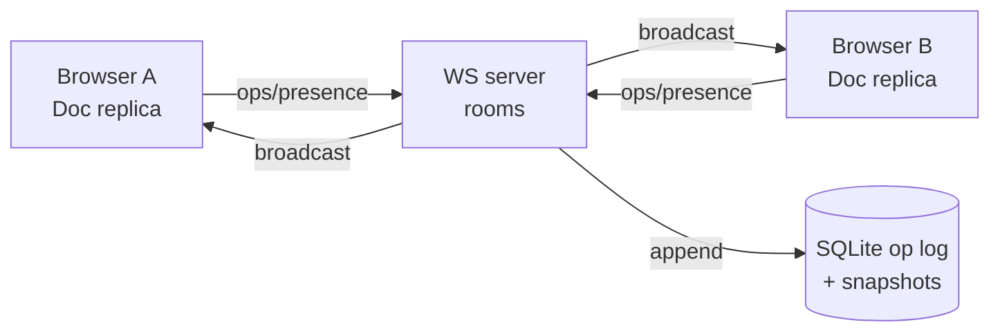

# collab-canvas — Design

## Problem
A real-time collaborative whiteboard where several users draw, move, recolor and delete shapes at once, see each other's cursors, and always converge to the same document — built on a **hand-written CRDT** (no Yjs/Automerge). The interesting part is not the canvas, it is the guarantees: convergence under reordered, duplicated and delayed delivery, idempotent operations, and a server that is only a relay + durable log, never an arbiter.

What it shows a senior reviewer: applied distributed-systems reasoning (causality, LWW with total-order tie-breaks, idempotence), property-based convergence testing, a defensive WebSocket server (limits, validation, rate limiting), and a polished UI verified end-to-end with two real browsers.

## Scope for night 1 (MVP)
- `@collab-canvas/crdt`: pure, dependency-free document CRDT.
- `@collab-canvas/server`: Node WebSocket server (`ws`) with rooms, validation, limits, SQLite op-log + snapshots (`node:sqlite`).
- `@collab-canvas/web`: React + Vite client, `<canvas>` rendering of rectangles, ellipses and freehand strokes; select/move/delete/color; live presence cursors.
- Tests: unit + fast-check convergence properties (crdt), server integration tests over real sockets, one Playwright e2e with two browser contexts that converge.
- `npm run dev` starts server + web. README with screenshots captured by Playwright. CI on Node 22 and 24.

**Later nights:** offline edits + reconnection with per-replica version vectors and delta sync, time-travel slider over the op log, per-user undo, SVG export, latency metrics, Dockerfile/compose.

## Architecture
```
packages/
  crdt/    src/{clock.ts, doc.ts, ops.ts, index.ts}   (no deps)
  server/  src/{config.ts, protocol.ts, store.ts, room.ts, server.ts, main.ts}
  web/     src/{main.tsx, App.tsx, net.ts, render.ts, tools.ts, styles.css}
e2e/       two-clients.spec.ts, screenshots.spec.ts
```
npm workspaces, TypeScript `strict` everywhere, ESM, `engines.node >=22`.



### CRDT model (`packages/crdt`)
- **Replica id**: random string chosen by the client (`crypto.randomUUID()`), validated by the server (≤ 64 chars, `[A-Za-z0-9_-]`).
- **Hybrid stamp** `Stamp = { lamport: number; replica: string }`, total order: compare `lamport`, then `replica` lexicographically. `Clock` holds the local lamport counter; `tick()` returns a new stamp, `observe(stamp)` sets `lamport = max(local, remote)`.
- **Document** = map `shapeId → ShapeRecord`. Each shape is a set of independent **LWW registers**, one per field: `kind` (immutable, set on create), `x`, `y`, `w`, `h`, `points` (stroke, immutable after create), `fill`, `stroke`, `z` (fractional number for z-order), plus a **tombstone** `deleted` register.
- **Ops** (JSON-serialisable, each carries a unique `id = "<replica>:<lamport>"` and `stamp`):
  - `create { shape: ShapeInit }` — sets all registers with the op's stamp.
  - `update { shapeId, fields: Partial<MutableFields> }` — LWW per field.
  - `delete { shapeId }` — sets tombstone; delete wins over concurrent updates only if its stamp is greater (plain LWW, documented). Tombstones are kept so late updates cannot resurrect.
  - Update to an unknown shape is buffered as register values (the record is created lazily, `kind` unknown → not rendered until the create arrives). This makes application order-independent.
- **Invariants** (tested):
  1. Commutativity/convergence: any permutation of the same op set yields an identical `snapshot()`.
  2. Idempotence: applying an op twice equals applying it once (`seen` set of op ids).
  3. Monotonic clock: every locally produced stamp is greater than every stamp observed before it.
  4. Deleted shapes never reappear in `visibleShapes()`.
- **Public API**
  ```ts
  class Doc {
    constructor(replica: string)
    createShape(init: ShapeInit): CreateOp
    updateShape(id: string, fields: Partial<MutableFields>): UpdateOp
    deleteShape(id: string): DeleteOp
    apply(op: Op): boolean            // false if duplicate
    visibleShapes(): Shape[]          // sorted by (z, id)
    snapshot(): DocSnapshot           // canonical, JSON-stable
    static fromSnapshot(replica: string, s: DocSnapshot): Doc
  }
  function validateOp(x: unknown): Op | null   // strict structural validation with limits
  ```
  `validateOp` limits: ids ≤ 64 chars, coordinates finite and |v| ≤ 1e6, stroke ≤ 2000 points, colors match `^#[0-9a-f]{6}$`.

### Wire protocol (`packages/server/src/protocol.ts`)
JSON text frames, max 64 KiB. Client → server: `hello {room, replica}`, `op {op}`, `presence {x, y, name, color}`. Server → client: `welcome {snapshot, ops}` (snapshot + ops since snapshot), `op {op}`, `presence {replica, ...}`, `leave {replica}`, `error {code, message}`. Every inbound frame is parsed with a hand-written validator; invalid → `error` and, after 5 invalid frames, close with 1008.

### Server
- `ws` on `127.0.0.1:8787` by default (`HOST`/`PORT` env). `maxPayload` 64 KiB, max 200 connections total and 50 per room, room name `^[a-z0-9-]{1,32}$`.
- Token-bucket rate limit per connection: 60 ops/s burst 120; presence throttled to 30/s (excess dropped silently).
- Heartbeat ping every 15 s, terminate if no pong in 30 s. Hello must arrive within 5 s.
- `Room` keeps an in-memory `Doc` (server replica `"server"` only applies, never authors), broadcasts ops to other members, appends to store.
- `Store` (`node:sqlite`, `DatabaseSync`): tables `ops(room, seq INTEGER, id TEXT UNIQUE, json TEXT)` and `snapshots(room, seq, json)`. Snapshot every 500 ops; on room load: latest snapshot + ops after it. `:memory:` in tests. Prepared statements only.
- Graceful shutdown on SIGINT/SIGTERM.

### Web client
- `net.ts`: WebSocket wrapper with exponential reconnect; on reconnect re-sends `hello` and resubmits locally-generated ops not yet acknowledged by the welcome (server dedups by op id).
- `render.ts`: pure function `draw(ctx, shapes, selection, cursors)`; devicePixelRatio aware.
- `tools.ts`: pointer state machine for rect/ellipse/pen/select (drag to move, Delete key removes, palette changes fill).
- UI: toolbar, color palette, room name in URL hash (`#room=demo`), presence list, connection badge. `data-testid` on toolbar buttons and the canvas for e2e; `window.__ccDebug.shapes()` exposed only when `import.meta.env.DEV` for e2e assertions.

## Testing
- **crdt** (vitest + fast-check): clock ordering; each op type; property: 3 replicas generate random ops, every replica receives all ops in a random order with random duplicates → identical snapshots; property: snapshot round-trip; validator rejects fuzzed garbage without throwing.
- **server** (vitest): store round-trip and snapshot compaction; integration with real `ws` clients on an ephemeral port: two clients converge, late joiner gets the full state, oversized/invalid frames rejected, rate limit, room cap.
- **e2e** (Playwright, chromium): two contexts in the same room, A draws a rectangle, B sees it; B moves it, A sees new position; cursors visible. Screenshot spec writes `docs/screenshot.png`.
- Benchmarks (later night): ops/s apply throughput and broadcast latency, measured, not invented.

## Dependencies (pinned, lockfile committed)
- Runtime: `ws` (de-facto Node WebSocket lib), `react`, `react-dom`.
- Dev: `typescript`, `vite`, `@vitejs/plugin-react`, `vitest`, `fast-check`, `eslint` + `typescript-eslint`, `@playwright/test`, `concurrently`, `tsx`, `@types/*`.
- SQLite via built-in `node:sqlite` (Node ≥ 22.13, no native build). Trade-off: it emits an ExperimentalWarning on Node 22; accepted to avoid a native addon.

## Security risks
- Untrusted JSON from the network → strict validation, size caps, no prototype-pollution paths (validated objects are rebuilt field by field, never spread from input; reject `__proto__` keys implicitly by whitelisting).
- DoS: payload cap, rate limits, connection/room caps, hello timeout, heartbeat.
- Persistence: parameterised SQL only.
- Bind to `127.0.0.1` by default; no auth in MVP (documented limitation: rooms are capability-by-name).
- Rendering: canvas only, no `innerHTML`; user names rendered as text and capped at 32 chars.
